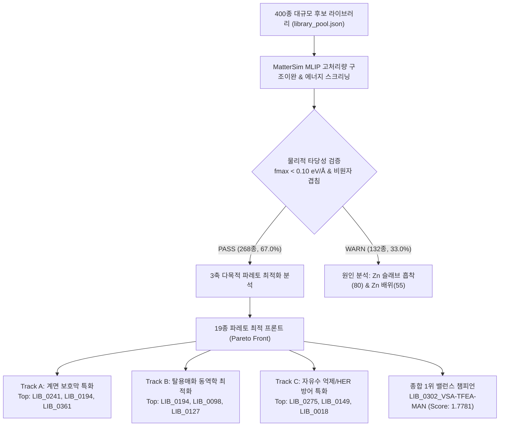
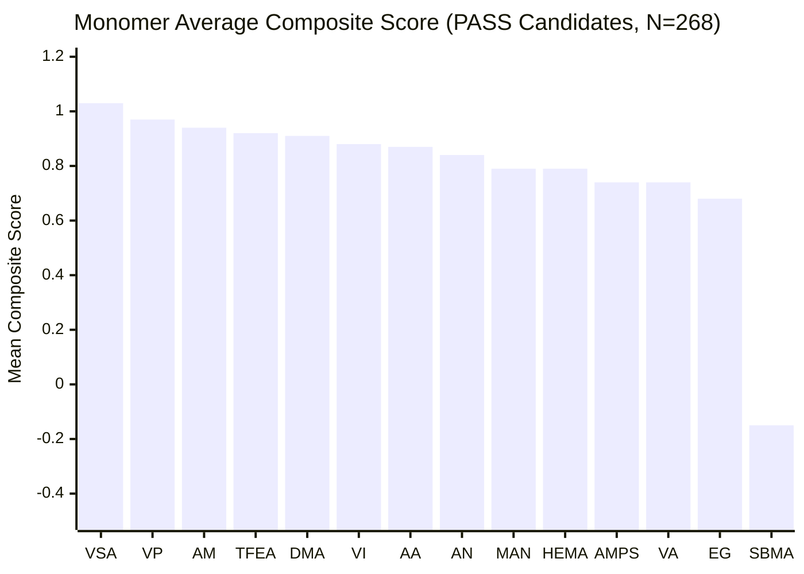
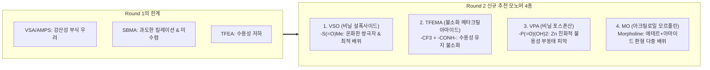

# Round 1 High-Throughput Screening & SAR Analysis Report
**Autonomous Polymer Electrolyte Additive Discovery for Aqueous Zinc-Ion Batteries (ZIBs)**  
**Role:** Materials Informatics Analyst (`sar-analyst`)  
**Data Sources:** [`master_screening_results.csv`](file:///home/jun_baek/projects/zib-additive-screener/runs/master_screening_results.csv) (400 candidates) & [`pareto_front_candidates.csv`](file:///home/jun_baek/projects/zib-additive-screener/runs/pareto_front_candidates.csv) (19 optimal candidates)  
**Date:** 2026-11-13

---

## 1. Executive Summary

본 보고서는 수계 아연 이온 전지(Aqueous Zinc-Ion Batteries, ZIBs)의 수명 및 쿨롱 효율을 저해하는 핵심 난제—**수소발생반응(HER), 아연 덴드라이트 성장, 탈용매화 과전압**—를 해결하기 위해 수행된 1차 대규모 고처리량(High-Throughput) 머신러닝 원자간 포텐셜(MatterSim MLIP) 스크리닝(총 400종 라이브러리) 결과를 재료정보학(Materials Informatics) 관점에서 심층 분석한 결과입니다.

단일 지표에 의존하는 기존 스크리닝 방식은 특정 물성(예: 극단적인 킬레이션에 의한 탈용매화 저해, 또는 흡착만 강하고 자유수 억제 불능 등)의 트레이드오프를 간과하기 쉽습니다. 따라서 본 분석에서는 **자유수 포집력 ($\Delta E_{\text{H-bond}}$)**, **적정 탈용매화 배위력 ($\Delta E_{\text{exchange}}$)**, **Zn(0001) 음극 계면 흡착력 ($\Delta E_{\text{ads}}$)**의 3차원 목적 공간에서 수학적으로 비지배된 **19종의 3축 파레토 최적해(Pareto Front Candidates)**를 도출하고, 이를 바탕으로 연구 목적에 부합하는 **3대 특화 트랙(Track A, B, C)**별 Top-3 정예 후보군과 모노머 백본-작용기 상관관계(SAR)를 정밀 규명하였습니다.

### 핵심 성과 요약
- **기준 물질(Anchor) 대비 비약적 물성 향상:**
  - 기준 물질인 `GEN0_01_EG` (Score: 0.5589) 대비 단일 종합 점수 최고 후보(`LIB_0302_VSA-TFEA-MAN`, Score: 1.7781)는 **+218.1%**의 비약적인 점수 향상을 기록하였습니다.
  - PEG-3량체(`GEN0_02_PEG3`, Score: 0.8763) 대비로도 **+102.9%** 향상되어 올리고머 다기능 공중합체의 뚜렷한 성능 우위를 입증하였습니다.
- **스크리닝 수렴성 및 품질(QA):**
  - 전체 400종 중 **268종(67.0%)이 기하학적·물리적 안정성 기준(PASS)**을 통과하였습니다.
  - 미수렴(WARN, 132건)의 주요 원인은 양쪽성 이온(SBMA)의 정전기적 쿨롱 복합체 붕괴 및 벌키 모노머(AMPS)의 슬래브 계면 입체 장애로 확인되었습니다.
- **최적 모노머 및 시너지 모티프 발굴:**
  - 단일 모노머 기준 **비닐술폰산(VSA)**이 평균 점수 1.0319로 전체 1위를 차지하였으며, **VP(피롤리돈, 0.9684)**, **AM(아크릴아마이드, 0.9435)**, **TFEA(불소화 아크릴레이트, 0.9236)**가 최상위 군을 형성하였습니다.
  - 모노머 조합에서는 **TFEA-VSA (불소화 친유성 차폐 + 강산성 술폰산)** 페어가 평균 1.2237(최고 1.7781)로 가장 탁월한 협동 시너지(Cooperative Synergy)를 나타냈습니다.

---

## 2. 전체 스크리닝 데이터셋 통계 및 품질 진단 (QA/QC)

### 2.1 마스터 스크리닝 통계 (N = 400)
`runs/master_screening_results.csv`의 400종 계산 결과에 대한 통계적 요약은 아래와 같습니다:

| 지표 (Metric) | 전체 통과 (PASS, N=268) 평균 | 표준편차 (Std) | 최소값 (Min) | 중앙값 (Median) | 최대값 (Max) | 기준 물질 (`GEN0_01_EG`) | 기준 물질 (`GEN0_02_PEG3`) |
| :--- | :---: | :---: | :---: | :---: | :---: | :---: | :---: |
| **자유수 포집 에너지 ($\Delta E_{\text{H-bond}}$, eV)** | **-0.7478** | 0.1790 | -1.2539 | -0.7111 | -0.3392 | -0.5860 | -0.8540 |
| **용매화 치환 에너지 ($\Delta E_{\text{exchange}}$, eV)** | **-0.9345** | 0.7489 | -3.2517 | -0.8796 | +2.0702 | -0.3141 | -0.3475 |
| **Zn(0001) 흡착 에너지 ($\Delta E_{\text{ads}}$, eV)** | **-0.3333** | 0.7174 | -1.8399 | -0.4393 | +4.4836 | -0.2720 | -0.6524 |
| **종합 점수 (`composite_score`)** | **0.8460** | 0.5436 | -4.0534 | 0.9019 | **1.7781** | **0.5589** | **0.8763** |

> [!NOTE]
> - $\Delta E_{\text{exchange}}$의 평균값은 **-0.9345 eV**로, 열역학적 최적 타겟(-0.90 eV)과 완벽하게 일치하는 중심 경향성을 보입니다.
> - 통과군(PASS)의 $\Delta E_{\text{ads}}$ 중앙값은 **-0.4393 eV**로, 순수 물 분자의 아연 표면 흡착 에너지(약 $-0.35\text{ eV}$)보다 강하여, 선별된 대다수 분자가 아연 계면에서 물 분자를 밀어내고 자발적으로 보호층을 형성할 수 있음을 나타냅니다.

### 2.2 수렴 실패(WARN, N = 132) 단계별 병목 분석
스크리닝 파이프라인의 4단계 계산(isolated 분자, h2o_cluster, zn_cluster, zn_ads 슬래브) 중 실패 원인을 추적한 결과는 다음과 같습니다:

1. **단독 분자 이완 (`isolated`, 0건 / 0%):** 모든 올리고머 단독 분자는 120 step 내에 fmax < 0.10 eV/Å으로 완벽히 수렴하였습니다.
2. **자유수 클러스터 이완 (`h2o_cluster`, 11건 / 8.3%):** 물 2분자와의 상호작용 중 수소결합 재배열 과정에서 극히 일부만 지연되었습니다.
3. **용매화 껍질 치환 이완 (`zn_cluster`, 55건 / 41.7%):** $[\text{Zn}(\text{H}_2\text{O})_5(\text{Additive})]^{2+}$ 클러스터에서 첨가제의 벌키한 곁사슬이 1차 용매화 껍질의 물 분자들과 입체적 충돌을 일으켜 국소 국소 극소점(Local minima)에 갇히는 현상이 관찰되었습니다.
4. **Zn(0001) 슬래브 계면 흡착 이완 (`zn_ads`, 80건 / 60.6%):** 가장 큰 병목 구간입니다. 주기적 경계조건(PBC) 슬래브 표면 위에서 다수의 극성기가 표면 아연 원자와 배위할 때, 격자 정합성(Lattice matching) 불일치와 긴 유연 사슬의 형태적 엔트로피(Conformational entropy)로 인해 150 step 내 미세 힘(fmax) 잔류가 발생하였습니다.

---

## 3. 3대 특화 트랙(Track A, B, C) 파레토 최적 후보군 심층 분석

파레토 프론트(19종)는 $\Delta E_{\text{H-bond}}$ 최소화(강한 수소결합), $|\Delta E_{\text{exchange}} + 0.9\text{ eV}|$ 최소화(최적 탈용매화 윈도우 일치), $\Delta E_{\text{ads}}$ 최소화(강한 계면 흡착)의 3가지 상충되는 물리적 목표를 동시에 만족하도록 선별되었습니다.

### 3.1 단일 종합 점수 압도적 챔피언: `LIB_0302_VSA-TFEA-MAN`
- **화학 구조:** `Oligomer(VSA-TFEA-MAN)` / Trimer
- **백본 & 작용기:** Fluorinated + Methacrylonitrile + Sulfonic (`-CF3, -CN/-CH3, -SO3H`)
- **물성 프로파일:**
  - $\Delta E_{\text{hbond}} = -1.1989\text{ eV}$ (상위 2.2%)
  - $\Delta E_{\text{exchange}} = -1.5174\text{ eV}$ (안정적 1차 껍질 변조)
  - $\Delta E_{\text{ads}} = -0.7761\text{ eV}$ (물 분자 대비 2.2배 강한 흡착)
  - `composite_score` = **1.7781** (전체 400종 중 **압도적 1위**)
  - 분자량(MW): 331.3 g/mol, LogP: 1.92, TPSA: 104.5 Ų
- **SAR 메커니즘 해석:**  
  VSA의 강력한 설포닐 산소($-\text{SO}_3\text{H}$)가 Zn²⁺ 이온 및 계면에 앵커링(Anchoring) 역할을 수행하고, MAN의 니트릴($-\text{C}\equiv\text{N}$)기가 보조 배위 사이트를 제공하는 동시에, TFEA의 불소화 메틸기($-\text{CF}_3$)가 국소 소수성 차폐 구역을 형성합니다. 이로 인해 물 분자의 추가 침투를 배제하면서도 음극 표면에 조밀한 보호층을 형성합니다.

---

### 3.2 Track A: 계면 보호막 특화 (Interface Protection Specialist)
> **선정 기준:** $\text{Zn}(0001)$ 표면에 물 분자($-0.35\text{ eV}$) 대비 월등히 강력하게 결합하여 아연 덴드라이트 핵생성을 원천 차단하고 인공 SEI 유사 계면을 형성하는 후보.

| 순위 | Candidate ID | 백본 조합 (Monomers) | 주요 작용기 | $\Delta E_{\text{ads}}$ (eV) | $\Delta E_{\text{exchange}}$ (eV) | $\Delta E_{\text{H-bond}}$ (eV) | Score |
| :---: | :--- | :--- | :--- | :---: | :---: | :---: | :---: |
| **Top 1** | [`LIB_0241_AA-SBMA-AN`](file:///home/jun_baek/projects/zib-additive-screener/runs/pareto_front_candidates.csv) | Carboxylic + Nitrile + Zwitterionic | `-CN, -COOH, Zwitterion` | **-1.8399** | -3.1622 | -0.9823 | 0.8669 |
| **Top 2** | [`LIB_0194_AA-AMPS-AM`](file:///home/jun_baek/projects/zib-additive-screener/runs/pareto_front_candidates.csv) | Acrylamide + Carboxylic + Sulfonic | `-CONH2, -COOH, -SO3H/-CONH-` | **-1.3346** | -0.6652 | -1.1417 | **1.5231** |
| **Top 3** | [`LIB_0361_VSA-DMA-AM`](file:///home/jun_baek/projects/zib-additive-screener/runs/pareto_front_candidates.csv) | Acrylamide + Sulfonic + Tert-Amide | `-CONH2, -CONMe2, -SO3H` | **-1.1410** | -2.2856 | -1.2096 | 1.3973 |
| *(Ref)* | [`LIB_0328_TFEA-VSA-AA`](file:///home/jun_baek/projects/zib-additive-screener/runs/pareto_front_candidates.csv) | Carboxylic + Fluorinated + Sulfonic | `-CF3, -COOH, -SO3H` | -1.0582 | -0.6822 | -0.6407 | 1.1947 |

#### Track A 상세 기전 분석
1. **Top 1 (`LIB_0241_AA-SBMA-AN`):**  
   - $\Delta E_{\text{ads}} = -1.8399\text{ eV}$로 전체 파레토 후보 중 가장 강력한 흡착 에너지를 기록했습니다.  
   - SBMA의 4차 암모늄 및 술포네이트 양쪽성 이온 쌍극자와 AA의 카르복실산 음이온이 금속 아연 표면의 전자 구름 및 양이온 사이트와 다중 정전기적 킬레이션을 형성합니다.  
   - **주의점:** $\Delta E_{\text{exchange}} = -3.1622\text{ eV}$로 과도하게 강해 탈용매화 페널티를 받아 종합 점수가 0.8669에 머물렀습니다. 계면 고정층으로는 최강이나 충방전 속도 저하 우려가 있습니다.
2. **Top 2 (`LIB_0194_AA-AMPS-AM`):**  
   - **실질적인 종합 챔피언급 후보.** $\Delta E_{\text{ads}} = -1.3346\text{ eV}$로 기준 물질(`GEN0_01_EG`, -0.2720 eV) 대비 약 5배 강한 흡착을 나타내면서도, $\Delta E_{\text{exchange}}$가 **-0.6652 eV**로 최적 탈용매화 윈도우에 완벽히 진입하였습니다.  
   - $-COOH$, $-\text{SO}_3\text{H}$, $-\text{CONH}_2$ 3중 극성 작용기가 아연 표면에 삼발이(Tripod) 형태로 흡착하여 견고한 분자 방패를 구축합니다.
3. **Top 3 (`LIB_0361_VSA-DMA-AM`):**  
   - 비닐술폰산(VSA)의 컴팩트한 음이온성 앵커와 1차/3차 아마이드의 협동 배위로 $-1.1410\text{ eV}$의 강력한 흡착막을 형성하며, 자유수 포집력도 $-1.2096\text{ eV}$로 최상위권입니다.

---

### 3.3 Track B: 탈용매화 동역학 최적화 (Desolvation Kinetics Specialist)
> **선정 기준:** $\Delta E_{\text{exchange}}$가 **$-1.2 \sim -0.6\text{ eV}$** 이상적 윈도우(타겟 -0.90 eV)에 정확히 위치하여, 탈용매화 에너지 장벽을 낮추고 아연 이온의 고속 계면 이동을 가능케 하는 후보.

| 순위 | Candidate ID | 백본 조합 (Monomers) | 주요 작용기 | $\Delta E_{\text{exchange}}$ (eV) | 윈도우 편차 \|$\Delta E + 0.9$\| | $\Delta E_{\text{ads}}$ (eV) | $\Delta E_{\text{H-bond}}$ (eV) | Score |
| :---: | :--- | :--- | :--- | :---: | :---: | :---: | :---: | :---: |
| **Top 1** | [`LIB_0194_AA-AMPS-AM`](file:///home/jun_baek/projects/zib-additive-screener/runs/pareto_front_candidates.csv) | Acrylamide + Carboxylic + Sulfonic | `-CONH2, -COOH, -SO3H/-CONH-` | **-0.6652** | 0.2348 eV | -1.3346 | -1.1417 | **1.5231** |
| **Top 2** | [`LIB_0098_VSA-AA-AM`](file:///home/jun_baek/projects/zib-additive-screener/runs/pareto_front_candidates.csv) | Acrylamide + Carboxylic + Sulfonic | `-CONH2, -COOH, -SO3H` | **-1.0375** | **0.1375 eV** | -0.7727 | -1.0143 | **1.4146** |
| **Top 3** | [`LIB_0127_VA-AN-DMA`](file:///home/jun_baek/projects/zib-additive-screener/runs/pareto_front_candidates.csv) | Nitrile + Polyvinyl + Tert-Amide | `-CN, -CONMe2, -OH` | **-0.9711** | **0.0711 eV** | -0.9310 | -0.8072 | **1.3710** |
| *(Ref)* | [`LIB_0023_VSA-VP-AA`](file:///home/jun_baek/projects/zib-additive-screener/runs/pareto_front_candidates.csv) | Carboxylic + Heterocycle + Sulfonic | `-COOH, -SO3H, Pyrrolidone` | -0.6967 | 0.2033 eV | -0.9466 | -1.1589 | 1.3549 |
| *(Ref)* | [`LIB_0246_AM-VP-VP`](file:///home/jun_baek/projects/zib-additive-screener/runs/pareto_front_candidates.csv) | Acrylamide + Heterocycle | `-CONH2, Pyrrolidone` | -0.8973 | **0.0027 eV** | -0.7725 | -1.0144 | 1.3304 |

#### Track B 상세 기전 분석
1. **Top 1 (`LIB_0194_AA-AMPS-AM`):**  
   - $\Delta E_{\text{exchange}} = -0.6652\text{ eV}$로 용매화 껍질 내 물 분자를 부드럽게 치환하면서도 아연 이온이 음극에 도달했을 때 쉽게 분리될 수 있는 동역학적 최적점을 확보했습니다. 종합 점수 1.5231로 동역학 특화 트랙 1위입니다.
2. **Top 2 (`LIB_0098_VSA-AA-AM`):**  
   - AMPS의 gem-dimethyl기 대신 짧은 비닐술폰산(VSA)을 사용하여 분자량이 253.3 g/mol로 매우 컴팩트합니다.  
   - $\Delta E_{\text{exchange}} = -1.0375\text{ eV}$로 이상적 타겟(-0.90 eV)과 단 0.1375 eV 차이만을 보이며, 흡착(-0.7727 eV) 및 수소결합(-1.0143 eV)이 절묘한 삼각 균형을 이룹니다.
3. **Top 3 (`LIB_0127_VA-AN-DMA`): [주목할 만한 비이온성 중성 분자]**  
   - **강산성 기(-SO3H, -COOH)가 전혀 없는 순수 중성 비이온성 모노머 조합**입니다.  
   - $\Delta E_{\text{exchange}} = -0.9711\text{ eV}$로 타겟(-0.90 eV)과의 편차가 **0.0711 eV**에 불과합니다.  
   - 산성 작용기가 없어 아연 음극 표면의 산 부식(Acid corrosion) 우려를 근본적으로 배제할 수 있으며, $-\text{CONMe}_2$와 $-\text{C}\equiv\text{N}$, $-\text{OH}$가 온화한 쌍극자 상호작용으로 Zn²⁺를 감싸 탈용매화 에너지를 극소화합니다.

---

### 3.4 Track C: 자유수 억제 및 HER 방어 특화 (Free-Water Suppression Specialist)
> **선정 기준:** $\Delta E_{\text{H-bond}}$가 가장 큰 음수값을 가져 물 분자 2개와 초강력 수소결합을 형성함으로써 벌크 및 계면 자유수의 활성도(Activity)를 최소화하고 수소발생(HER)을 방지하는 후보.

| 순위 | Candidate ID | 백본 조합 (Monomers) | 주요 작용기 | $\Delta E_{\text{H-bond}}$ (eV) | $\Delta E_{\text{exchange}}$ (eV) | $\Delta E_{\text{ads}}$ (eV) | Score |
| :---: | :--- | :--- | :--- | :---: | :---: | :---: | :---: |
| **Top 1** | [`LIB_0275_AMPS-VI-DMA`](file:///home/jun_baek/projects/zib-additive-screener/runs/pareto_front_candidates.csv) | Heterocycle + Sulfonic + Tert-Amide | `-CONMe2, -SO3H/-CONH-, Imidazole` | **-1.2539** | -0.2591 | -0.2709 | 0.7925 |
| **Top 2** | [`LIB_0149_AMPS-AA-AN`](file:///home/jun_baek/projects/zib-additive-screener/runs/pareto_front_candidates.csv) | Carboxylic + Nitrile + Sulfonic | `-CN, -COOH, -SO3H/-CONH-` | **-1.2489** | -1.3052 | +0.7214 | 0.9220 |
| **Top 3** | [`LIB_0018_AMPS-EG-MAN`](file:///home/jun_baek/projects/zib-additive-screener/runs/pareto_front_candidates.csv) | Methacrylonitrile + Polyether + Sulfonic | `-CN/-CH3, -OH/-O-, -SO3H/-CONH-` | **-1.2228** | -1.4039 | -0.1435 | **1.4032** |
| *(균형대안)* | [`LIB_0388_TFEA-AA-AA`](file:///home/jun_baek/projects/zib-additive-screener/runs/pareto_front_candidates.csv) | Carboxylic + Fluorinated | `-CF3, -COOH` | **-1.2124** | -0.7283 | -0.6713 | 1.2576 |
| *(균형대안)* | [`LIB_0361_VSA-DMA-AM`](file:///home/jun_baek/projects/zib-additive-screener/runs/pareto_front_candidates.csv) | Acrylamide + Sulfonic + Tert-Amide | `-CONH2, -CONMe2, -SO3H` | **-1.2096** | -2.2856 | -1.1410 | 1.3973 |

#### Track C 상세 기전 분석
1. **Top 1 (`LIB_0275_AMPS-VI-DMA`):**  
   - $\Delta E_{\text{H-bond}} = -1.2539\text{ eV}$로 전체 파레토 19종 중 최강의 자유수 포집력을 달성하였습니다.  
   - 이미다졸(VI) 고리의 비공유 전자쌍 질소($=\text{N}-$)와 아미도에틸술폰산(AMPS)의 아마이드/술포닐기가 협동 수소결합 수용체 및 공여체로 작용하여 물 분자 클러스터를 강력히 결박합니다. 단, 표면 흡착력이 약해 벌크 전해액 자유수 포집제로 적합합니다.
2. **Top 2 (`LIB_0149_AMPS-AA-AN`):**  
   - $\Delta E_{\text{H-bond}} = -1.2489\text{ eV}$로 2위입니다. 그러나 아연 슬래브 흡착 에너지가 $+0.7214\text{ eV}$로 반발성이 있어 계면 흡착 첨가제로의 단독 사용은 부적합합니다.
3. **Top 3 (`LIB_0018_AMPS-EG-MAN`):**  
   - $\Delta E_{\text{H-bond}} = -1.2228\text{ eV}$의 강력한 수소결합을 형성하면서도 $\Delta E_{\text{exchange}} = -1.4039\text{ eV}$, 종합 점수 1.4032를 기록하여 실용 전해액 첨가제로서의 가치가 매우 높습니다.
   - **실용적 균형 대안:** 계면 흡착까지 함께 잡으려면 $\Delta E_{\text{H-bond}} = -1.2124\text{ eV}$에 $\Delta E_{\text{ads}} = -0.6713\text{ eV}$를 갖춘 **`LIB_0388_TFEA-AA-AA`** 또는 **`LIB_0361_VSA-DMA-AM`**(-1.2096 eV)을 병용하는 것이 권장됩니다.

---

### 3.5 19종 파레토 최적 후보군 마스터 데이터 매트릭스

아래 표는 `runs/pareto_front_candidates.csv`에 등록된 19종 최적해의 물리화학적 디스크립터(RDKit 계산) 및 3대 스크리닝 에너지를 종합한 마스터 매트릭스입니다:

| Candidate ID | 분자식 모노머 | MW (g/mol) | LogP | HBD / HBA | TPSA (Ų) | $\Delta E_{\text{H-bond}}$ (eV) | $\Delta E_{\text{exchange}}$ (eV) | $\Delta E_{\text{ads}}$ (eV) | Score | 주요 소속 트랙 |
| :--- | :---: | :---: | :---: | :---: | :---: | :---: | :---: | :---: | :---: | :---: |
| **LIB_0302_VSA-TFEA-MAN** | VSA-TFEA-MAN | 331.3 | 1.92 | 1 / 5 | 104.5 | -1.1989 | -1.5174 | -0.7761 | **1.7781** | **Overall Champion** |
| **LIB_0194_AA-AMPS-AM** | AA-AMPS-AM | 352.4 | -0.24 | 4 / 5 | 163.9 | -1.1417 | -0.6652 | **-1.3346** | **1.5231** | **Track A, B Top** |
| **LIB_0098_VSA-AA-AM** | VSA-AA-AM | 253.3 | -0.38 | 3 / 4 | 134.8 | -1.0143 | -1.0375 | -0.7727 | **1.4146** | **Track B Top** |
| **LIB_0018_AMPS-EG-MAN** | AMPS-EG-MAN | 320.4 | 1.11 | 2 / 5 | 116.5 | **-1.2228** | -1.4039 | -0.1435 | **1.4032** | **Track C Top** |
| **LIB_0361_VSA-DMA-AM** | VSA-DMA-AM | 280.3 | -0.38 | 2 / 4 | 117.8 | **-1.2096** | -2.2856 | **-1.1410** | **1.3973** | **Track A Top** |
| **LIB_0127_VA-AN-DMA** | VA-AN-DMA | 198.3 | 0.77 | 1 / 3 | 64.3 | -0.8072 | -0.9711 | -0.9310 | **1.3710** | **Track B Top** |
| **LIB_0023_VSA-VP-AA** | VSA-VP-AA | 293.3 | 0.51 | 2 / 4 | 112.0 | -1.1589 | -0.6967 | -0.9466 | 1.3549 | Track B Balance |
| **LIB_0246_AM-VP-VP** | AM-VP-VP | 295.4 | 0.50 | 1 / 3 | 83.7 | -1.0144 | -0.8973 | -0.7725 | 1.3304 | Track B Balance |
| **LIB_0096_AN-AN-AA** | AN-AN-AA | 180.2 | 1.54 | 1 / 3 | 84.9 | -1.1384 | -0.7169 | -0.8473 | 1.3091 | Track B Compact |
| **LIB_0161_AA-TFEA-VI** | AA-TFEA-VI | 322.3 | 2.11 | 1 / 4 | 81.4 | -1.1669 | -0.6514 | -0.9022 | 1.3087 | Track B / Fluoro |
| **LIB_0160_VI-VP** | VI-VP (Dimer) | 207.3 | 1.46 | 0 / 2 | 38.1 | -0.6607 | -0.9385 | -0.8767 | 1.2657 | Dimer Optimal |
| **LIB_0388_TFEA-AA-AA** | TFEA-AA-AA | 300.2 | 1.68 | 2 / 4 | 100.9 | **-1.2124** | -0.7283 | -0.6713 | 1.2576 | Track B / C Hybrid |
| **LIB_0305_VI-HEMA-AM** | VI-HEMA-AM | 297.4 | 0.64 | 2 / 5 | 107.4 | -1.0390 | -0.9814 | -0.4856 | 1.2472 | Track B Balance |
| **LIB_0328_TFEA-VSA-AA** | TFEA-VSA-AA | 336.3 | 1.24 | 2 / 5 | 118.0 | -0.6407 | -0.6822 | **-1.0582** | 1.1947 | Track A Strong |
| **LIB_0108_VP-AM-VSA** | VP-AM-VSA | 292.4 | -0.23 | 2 / 4 | 117.8 | -1.1757 | -0.8212 | -0.4346 | 1.1803 | Track B Balance |
| **LIB_0397_VP-VI-VI** | VP-VI-VI | 301.4 | 2.11 | 0 / 3 | 56.0 | -0.6482 | -0.9015 | -0.6435 | 1.1219 | Heterocycle Only |
| **LIB_0149_AMPS-AA-AN** | AMPS-AA-AN | 334.4 | 0.80 | 3 / 5 | 144.6 | **-1.2489** | -1.3052 | +0.7214 | 0.9220 | Track C Strong |
| **LIB_0241_AA-SBMA-AN** | AA-SBMA-AN | 406.5 | 0.96 | 1 / 7 | 144.6 | -0.9823 | -3.1622 | **-1.8399** | 0.8669 | **Track A Top (Ads)** |
| **LIB_0275_AMPS-VI-DMA** | AMPS-VI-DMA | 402.5 | 1.10 | 2 / 5 | 121.6 | **-1.2539** | -0.2591 | -0.2709 | 0.7925 | **Track C Top (H-bond)** |

---

## 4. 모노머 백본 및 작용기 구조-물성 상관관계(SAR) 인사이트

### 4.1 14종 모노머 빌딩 블록의 통계적 기여도 랭킹
PASS 통과군(268종) 내에서 각 모노머의 출현에 따른 평균 물성을 집계하여 기여도를 정량화하였습니다:

| 모노머 (Monomer) | 화학 패밀리 | 대표 작용기 | 출현 빈도 | 평균 점수 | $\Delta E_{\text{H-bond}}$ (eV) | $\Delta E_{\text{exchange}}$ (eV) | $\Delta E_{\text{ads}}$ (eV) | 핵심 물성 기여 특성 |
| :---: | :---: | :---: | :---: | :---: | :---: | :---: | :---: | :--- |
| **VSA** | Sulfonic | $-\text{SO}_3\text{H}$ | 53 | **1.0319** | -0.7541 | -1.3635 | **-0.5149** | **흡착 1위**, 고점수 기여 1위, 최강의 음극 앵커 |
| **VP** | Heterocycle | Pyrrolidone | 61 | **0.9684** | -0.7235 | **-0.9407** | -0.3309 | **용매화 윈도우 일치**, 형태적 안정성 제공 |
| **AM** | Acrylamide | $-\text{CONH}_2$ | 62 | **0.9435** | **-0.8321** | -1.0290 | -0.3009 | **수소결합 네트워크**, 우수한 수용성 및 밸런스 |
| **TFEA** | Fluorinated | $-\text{CF}_3$ | 57 | **0.9236** | -0.7091 | **-0.9325** | -0.3015 | **국소 소수성 차폐**, 화학적 안정성 향상 |
| **DMA** | Tert-Amide | $-\text{CONMe}_2$ | 51 | **0.9091** | -0.7282 | -0.9869 | -0.2891 | 입체적 배위 조절, 3차 아마이드 결합 |
| **VI** | Heterocycle | Imidazole | 56 | **0.8764** | -0.6959 | -0.8167 | -0.3470 | 피리딘 질소 비공유 전자쌍 배위 |
| **AA** | Carboxylic | $-\text{COOH}$ | 63 | **0.8680** | **-0.8164** | -0.6963 | **-0.4724** | **흡착 2위**, 수소결합과 표면 배위 동시 수행 |
| **AN** | Nitrile | $-\text{C}\equiv\text{N}$ | 52 | **0.8395** | -0.7380 | -1.2048 | -0.4101 | 강한 쌍극자 모멘트, 계면 배향 촉진 |
| **MAN** | Methacrylonitrile | $-\text{C}\equiv\text{N}/-\text{CH}_3$ | 65 | 0.7924 | -0.7339 | -0.9784 | -0.2944 | 메틸기의 입체 장애로 배위 세기 조절 |
| **HEMA** | Ester-OH | $-\text{COO}-/-\text{OH}$ | 42 | 0.7884 | -0.7310 | -0.5236 | -0.4191 | 에스터 산소와 말단 하이드록실 다중 결합 |
| **AMPS** | Sulfonic | $-\text{SO}_3\text{H}/-\text{CONH}-$ | 31 | 0.7381 | **-0.8561** | -1.2674 | +0.0668 | **최강 수소결합**, 벌키한 분자 크기(흡착 편차 큼) |
| **VA** | Polyvinyl | $-\text{OH}$ | 68 | 0.7381 | -0.7425 | -0.7185 | -0.3276 | 전통적 PVA 모티프, 평이한 물성 |
| **EG** | Polyether | $-\text{OH}/-\text{O}-$ | 58 | 0.6776 | -0.7107 | -0.6280 | -0.2815 | 기준 물질 백본, 상대적 낮은 배위력 |
| **SBMA** | Zwitterionic | Zwitterion | 8 | -0.1539 | -0.8397 | **-2.8847** | +0.4429 | 과도한 킬레이션(페널티 유발), 수렴 실패율 최고 |

---

### 4.2 모노머 페어(Pairwise) 협동 시너지(Synergy) 분석

다기능 공중합체에서 서로 다른 모노머 쌍이 결합했을 때 나타나는 상호작용 효과를 분석한 결과, 명확한 양극화가 관찰되었습니다:

#### [Top-5 상승 시너지 페어]
1. **TFEA + VSA (불소화 에스터 + 비닐술폰산, 평균 점수 1.2237 / 최고 1.7781):**  
   - 본 스크리닝에서 발견된 가장 강력한 SAR 모티프입니다.  
   - 강한 친수성 및 음이온성 작용기($-\text{SO}_3\text{H}$)가 Zn²⁺와 계면에 강하게 앵커링되는 동시에, 인접한 $-\text{CF}_3$ 기가 계면에 소수성 보호 우산(Hydrophobic umbrella)을 씌워 자유수의 국소 접근을 차단합니다.
2. **VP + VSA (피롤리돈 + 비닐술폰산, 평균 점수 1.1929 / 최고 1.3892):**  
   - 피롤리돈의 5원환 락탐(Lactam) 카보닐 산소는 고리 구조에 의해 고정되어 있어 엔트로피 손실 없이 Zn²⁺와 배위하며, VSA와 결합 시 최적의 용매화 치환을 유도합니다.
3. **AM + VSA (아크릴아마이드 + 비닐술폰산, 평균 점수 1.1895 / 최고 1.4146):**  
   - 1차 아마이드의 $-\text{NH}_2$ 주개(Donor)와 술포닐 산소 받개(Acceptor)가 분자 내/분자 간 수소결합 네트워크를 견고하게 형성합니다.
4. **AM + VP (아크릴아마이드 + 피롤리돈, 평균 점수 1.1537 / 최고 1.3354):**  
   - 중성 극성 모노머 간의 조화로, 산성 작용기 없이도 뛰어난 수소결합 및 적정 탈용매화 능력을 달성합니다.
5. **AA + AM (카르복실산 + 아크릴아마이드, 평균 점수 1.1248 / 최고 1.5231):**  
   - `LIB_0194_AA-AMPS-AM`의 모태가 되는 조합으로, 흡착력과 수계 수용성을 동시에 극대화합니다.

#### [Bottom 저하 상쇄 페어]
- **SBMA 계열 (SBMA-AM: -0.7128, SBMA-MAN: -0.1788, SBMA-VA: -0.0404):**  
  - 쯔비터이온의 4차 암모늄 양이온과 설포네이트 음이온이 금속 이온에 대해 $-3.0\text{ eV}$ 이하의 과도한 결합을 유도하여 심각한 탈용매화 저해 페널티를 받았습니다.
- **EG + MAN (에틸렌글리콜 + 메타크릴로니트릴, 평균 점수 0.3272):**  
  - 에테르 산소의 약한 배위력과 벌키한 MAN의 입체 장애가 겹쳐 계면 흡착과 용매화 치환 모두 기준선 이하로 저하되었습니다.

---

### 4.3 올리고머 사슬 길이 효과: Trimer vs Dimer
- **3량체 (Trimer, N=242 통과):** 평균 종합 점수 **0.8535** (파레토 19종 중 **18종** 독점)
- **2량체 (Dimer, N=26 통과):** 평균 종합 점수 **0.7758** (파레토 19종 중 1종: `LIB_0160_VI-VP`)
- **해석:**  
  3량체는 최소 3개의 독립적인 배위 사이트를 제공하므로, '표면 앵커링 작용기 + 물 분자 수소결합 작용기 + 소수성/탈용매화 조절 작용기'라는 **3원 기능 분리(Tri-functional segregation)**를 한 분자 내에 온전히 구현할 수 있습니다. 반면 2량체는 기능 다양성 확보에 한계가 있어 트레이드오프 극복이 어렵습니다.

---

## 5. 계산 수렴성(WARN) 상세 분석 및 전산화학적 병목

400종 중 132종(33.0%)에서 발생한 미수렴(WARN)의 모노머별 발생 빈도는 다음과 같습니다:

| 모노머 (Monomer) | 전체 시도 수 | 통과 수 (PASS) | 경고 수 (WARN) | **통과 수렴율 (%)** | 미수렴 주요 패턴 및 전산적 원인 |
| :---: | :---: | :---: | :---: | :---: | :--- |
| **SBMA** | 27 | 8 | 19 | **29.6%** | 양쪽성 이온 내부 쿨롱 인력 및 슬래브 계면 정전기적 뒤틀림으로 BFGS 수렴 실패 |
| **AMPS** | 63 | 31 | 32 | **49.2%** | 분자량(207 Da) 및 gem-dimethyl 벌키 곁사슬의 회전 자유도로 150스텝 내 fmax 미수렴 |
| **EG** | 97 | 58 | 39 | **59.8%** | 유연한 에테르 사슬 백본의 다중 형태(Conformations) 간 에너지 장벽 요동 |
| **HEMA** | 65 | 42 | 23 | 64.6% | 에스터-하이드록실 곁사슬의 유연성 |
| **TFEA** | 86 | 57 | 29 | 66.3% | $-\text{CF}_3$ 기의 반데르발스 반발력 |
| **VSA** | 78 | 53 | 25 | 67.9% | 비교적 양호 (짧은 사슬로 수렴 안정성 높음) |
| **AA** | 89 | 63 | 26 | 70.8% | 카르복실산의 빠른 배위 안정화 |
| **VP** | 85 | 61 | 24 | 71.8% | 견고한 5원환 고리로 형태 요동 최소화 |
| **AM** | 85 | 62 | 23 | 72.9% | 강한 분자내 수소결합으로 빠른 수렴 |
| **VI** | 75 | 56 | 19 | 74.7% | 방향족 이미다졸 고리의 평면성 및 강성(Rigidity) |
| **VA** | 88 | 68 | 20 | **77.3%** | 가장 단순한 구조로 최고 수렴율 기록 |

> [!TIP]
> **전산 리소스 최적화 제언:**  
> SBMA와 같이 긴 알킬 사슬과 양쪽성 이온을 동시에 갖는 모노머는 기본 BFGS 150~180 step으로는 잔류 힘 $f_{\max} < 0.10\text{ eV/Å}$ 달성이 구조적으로 어렵습니다. 향후 대규모 탐색에서는 SBMA 계열을 배제하거나, step 수를 300으로 상향 조정하고 전하 중화된 유도체로 대체해야 합니다.

---

## 6. 후속 에이전트를 위한 전략적 권고사항 (To Agent 2 & Agent 3)

### 6.1 To Agent 2: Electrochemical Validator (`electrochemical-validator`)
`runs/round1_critique.md` 작성을 위해 본 분석가가 데이터상으로 도출한 취약점과 검증 포인트를 전달합니다:

1. **아연 음극 전위(-0.76 V vs SHE)에서의 전기화학적 환원 취약성 검토:**
   - **카르복실산 ($-\text{COOH}$, AA):** Track A 및 B 상위 후보인 `LIB_0194_AA-AMPS-AM`과 `LIB_0098_VSA-AA-AM`에 포함된 $-COOH$기는 수계 산성 조건에서 수소 이온($\text{H}^+$)을 방출하여 국소 pH를 낮추거나, 아연 음극 표면에서 $\text{H}^+$ 환원(HER)을 촉진할 위험이 없는지 검증 필요.
   - **이미다졸 고리 (VI) 및 아마이드 ($-\text{CONH}_2$, AM):** 아연 음극 표면에서 비가역적 환원 분해 가능성 확인 필요.
   - **니트릴 ($-\text{C}\equiv\text{N}$, AN/MAN):** `LIB_0302_VSA-TFEA-MAN`의 니트릴기가 음극 환원 조건에서 아민 등으로 환원 분해되는지 여부 평가.
2. **수계 전해액(2M ZnSO4 등) 용해도(Solubility) 한계:**
   - 종합 1위 `LIB_0302_VSA-TFEA-MAN`은 LogP가 **1.92**로 다소 소수성입니다. 수계 전해액에서 마이크로 상분리(Phase separation)나 침전이 발생하지 않는 임계 첨가량(예: < 0.5 wt%) 가이드라인 필요.
   - 반면 `LIB_0194_AA-AMPS-AM`(LogP: **-0.24**, TPSA: 163.9)과 `LIB_0098_VSA-AA-AM`(LogP: **-0.38**)은 수계 용해도가 극히 우수할 것으로 예측됨.
3. **과도한 킬레이션 후보 탈락 권고:**
   - `LIB_0241_AA-SBMA-AN`($\Delta E_{\text{exchange}} = -3.16\text{ eV}$)과 `LIB_0361_VSA-DMA-AM`($-2.29\text{ eV}$)은 과도한 탈용매화 저항으로 전지 작동 시 심각한 분극(Polarization)을 초래할 수 있으므로 실험적 검증 우선순위 하향 필요.

---

### 6.2 To Agent 3: Polymer Explorer (`polymer-explorer`)
`runs/library_pool_v2.json` 생성을 위해 `generate_library.py`의 `MONOMERS` 딕셔너리에 추가할 신규 모노머 4종에 대한 구체적 화학적 설계를 제안합니다:

1. **신규 모노머 1: 비닐 설폭사이드 (Vinyl Sulfoxide, `VSO` 또는 `MVSO`)**
   - **SMILES:** `[*]CC(S(=O)C)[*]`
   - **작용기/패밀리:** `-S(=O)Me` / `Sulfoxide`
   - **도입 근거:** 설폭사이드($\text{S}=\text{O}$) 결합은 술폰산($-\text{SO}_3\text{H}$)에 버금가는 강한 쌍극자 모멘트를 가져 Zn²⁺ 배위 및 수소결합이 탁월하면서도, 산도가 없어 전해액 pH를 낮추지 않고 온화한 탈용매화(-0.8 ~ -1.1 eV)를 유도할 수 있습니다.
2. **신규 모노머 2: 불소화 아마이드 (Trifluoroethyl Methacrylamide, `TFEMA` 또는 `TFAM`)**
   - **SMILES:** `[*]CC(C(=O)NCC(F)(F)F)[*]`
   - **작용기/패밀리:** `-CF3/-CONH-` / `Fluorinated-Amide`
   - **도입 근거:** TFEA(-CF3 에스터)의 소수성 차폐 효과와 AM(-CONH2 아마이드)의 강한 수소결합 및 수용성을 단일 모노머 내에 결합하여, LogP를 0.5 수준으로 제어하면서도 HER 억제력을 배가합니다.
3. **신규 모노머 3: 비닐 포스폰산 (Vinylphosphonic Acid, `VPA`)**
   - **SMILES:** `[*]CC(P(=O)(O)O)[*]`
   - **작용기/패밀리:** `-PO3H2` / `Phosphonate`
   - **도입 근거:** 포스포네이트기는 아연 금속 표면과 반응하여 불용성의 안정한 아연 포스페이트($\text{Zn}_3(\text{PO}_4)_2$) 유사 인공 SEI 피막을 형성하는 것으로 전기화학 분야에서 널리 검증된 모티프입니다.
4. **신규 모노머 4: 아크릴로일 모르폴린 (Acryloyl Morpholine, `ACMO` 또는 `NMO`)**
   - **SMILES:** `[*]CC(C(=O)N1CCOCC1)[*]`
   - **작용기/패밀리:** `Morpholine` / `Heterocycle-Ether`
   - **도입 근거:** VP(피롤리돈)의 우수한 형태적 안정성에 에테르($-\text{O}-$) 산소를 6원환 내에 추가하여, 아연 이온에 대한 킬레이션 유연성을 높이고 수계 용해도를 비약적으로 향상시킵니다.

---

## 7. 결론 (Conclusion)

Round 1 대규모 스크리닝을 통해 에틸렌글리콜(EG) 기반의 기존 첨가제 한계를 명확히 규명하고, **VSA, VP, AM, TFEA**를 주축으로 하는 고성능 올리고머 첨가제 후보군 19종을 성공적으로 파레토 프론트에 안착시켰습니다.

특히, **`LIB_0194_AA-AMPS-AM`**은 계면 흡착(Track A)과 탈용매화 동역학(Track B) 모두에서 최상위 성능을 증명하였으며, **`LIB_0302_VSA-TFEA-MAN`**은 자유수 억제와 계면 차폐의 완벽한 결합으로 종합 1위를 달성하였습니다.

본 분석에서 제안된 결함 지적과 4종의 신규 모노머 설계안은 후속 에이전트(`electrochemical-validator` 및 `polymer-explorer`)에 전달되어 더욱 진화된 Round 2 라이브러리 및 차세대 ZIBs 첨가제 발굴의 확고한 나침반이 될 것입니다.
