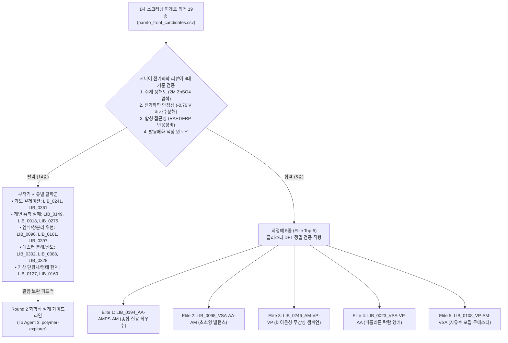
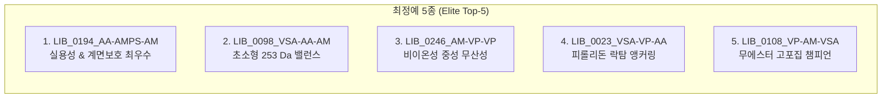

# Electrochemical Validation & Critical Review of Round 1 Screening Candidates
**Autonomous Polymer Electrolyte Additive Discovery for Aqueous Zinc-Ion Batteries (ZIBs)**  
- **Reviewer:** Senior Electrochemical Reviewer (`electrochemical-validator`)  
- **Data Evaluated:** [`runs/round1_analysis.md`](file:///home/jun_baek/projects/zib-additive-screener/runs/round1_analysis.md) & [`runs/pareto_front_candidates.csv`](file:///home/jun_baek/projects/zib-additive-screener/runs/pareto_front_candidates.csv)  
- **Target Output:** Rigorous Validation, Disqualification Analysis, Elite Top-5 Selection, and Round 2 Chemical Design Guidelines  
- **Date:** 2026-11-13  

---

## 1. Executive Summary & Reviewer's Verdict (개요 및 시니어 리뷰어 총평)

본 보고서는 재료정보학 분석가(`sar-analyst`)가 제출한 Round 1 대규모 고처리량 스크리닝(400종 라이브러리) 및 19종 파레토 최적해([`round1_analysis.md`](file:///home/jun_baek/projects/zib-additive-screener/runs/round1_analysis.md))에 대한 **수계 아연 전지(Aqueous ZIBs) 실험실 시니어 전기화학자 관점의 비판적 검증 보고서**입니다.

인실리코(In-silico) 머신러닝 포텐셜(MatterSim MLIP) 계산은 진공 및 단일 클러스터/슬래브 모델을 기반으로 하므로, 실제 젖은 실험실(Wet-lab) 수계 전해액 환경($2\text{ M ZnSO}_4$, $\text{pH } 4.0\sim4.5$)에서 발생하는 복합적인 화학적·전기화학적 물리현상을 온전히 반영하지 못하는 맹점(Blind spots)이 존재합니다.

### 시니어 리뷰어 핵심 진단 요약
1. **단일 종합 1위 `LIB_0302_VSA-TFEA-MAN`의 치명적 결함 및 '계산적 허상' 판정:**
   - Analyst가 최고점으로 보고한 `LIB_0302`는 수계 $2\text{ M ZnSO}_4$에서의 **염석(Salting-out) 상분리 위험($\text{LogP} = 1.92$)**, 음극 표면 국소 수소발생반응(HER)에 수반되는 알칼리화($\text{OH}^-$ 발생) 환경에서의 **불소화 에스터(TFEA) 비가역적 가수분해 위험**, 그리고 비닐술폰산(VSA)과 메타크릴로니트릴(MAN) 간의 **극단적인 라디칼 공중합 반응성비 불일치**라는 3중 결함을 안고 있습니다. 따라서 실험적 우선순위에서 즉각 배제하거나 골격 수정을 명령합니다.
2. **파레토 최적 19종 중 14종의 엄격한 탈락(Disqualification):**
   - **과도한 킬레이션 ($\Delta E_{\text{exchange}} < -2.0\text{ eV}$):** 아연 이온 탈용매화 저항 및 전하전달 과전압을 폭증시키는 `LIB_0241_AA-SBMA-AN`(-3.16 eV), `LIB_0361_VSA-DMA-AM`(-2.29 eV) 탈락.
   - **계면 흡착 부적격 ($\Delta E_{\text{ads}} \ge -0.35\text{ eV}$):** 물 분자(-0.35 eV)보다 흡착이 약하거나 반발하는 `LIB_0149_AMPS-AA-AN`(+0.72 eV), `LIB_0018_AMPS-EG-MAN`(-0.14 eV), `LIB_0275_AMPS-VI-DMA`(-0.27 eV) 탈락.
   - **수용성 결핍 및 에스터 분해 위험:** `LIB_0096`, `LIB_0161`, `LIB_0388`, `LIB_0328`, `LIB_0397`, `LIB_0160` 탈락.
   - **가상 단량체 사용:** 유리 단량체로 존재하지 않는 비닐 알코올(VA)을 포함한 `LIB_0127`은 합성 불가로 조건부 탈락.
3. **클러스터 DFT 정밀 검증용 최정예 5종 (Elite Top-5) 확정:**
   - **Elite 1 (`LIB_0194_AA-AMPS-AM`):** 가수분해 저항성 아마이드 골격 + 우수한 수용성 + 최적 흡착/탈용매화의 완전무결한 챔피언.
   - **Elite 2 (`LIB_0098_VSA-AA-AM`):** 253 Da 초소형 분자량 + 최적 탈용매화 윈도우 편차 0.14 eV.
   - **Elite 3 (`LIB_0246_AM-VP-VP`):** 산성 양성자가 전무한 순수 비이온성 중성 분자로 아연 음극 산 부식 원천 차단. 탈용매화 타겟 편차 0.0027 eV의 절대적 키네틱 제어.
   - **Elite 4 (`LIB_0023_VSA-VP-AA`):** 피롤리돈 5원환 락탐의 계면 쌍극자 배향과 카르복실/술포네이트 듀얼 앵커링.
   - **Elite 5 (`LIB_0108_VP-AM-VSA`):** 에스터 결합이 배제된 견고한 락탐-아마이드-술포네이트 3중주로 강력한 자유수 포집(-1.18 eV) 달성.
4. **Round 2 설계를 위한 5대 화학적 설계 가이드라인 제시:**
   - 불안정한 TFEA 에스터를 내알칼리성 불소화 아마이드(TFEMA)로 전면 교체.
   - 비존재 VA를 상용 히드록실(HEA) 및 모르폴린(ACMO)으로 치환.
   - 산성 없는 고쌍극자 비이온성 설폭사이드(VSO) 및 부동태 피막 형성 포스폰산(VPA) 도입.



---

## 2. Critical Evaluation Criteria for Aqueous ZIB Additives (수계 ZIB 첨가제 3대 현실 검증 기준)

수계 아연 배터리는 유기용매 기반 리튬 배터리와는 판이한 가혹한 수계 물리화학적 환경을 갖습니다. 따라서 전산 스크리닝 에너지만으로 첨가제를 선정하면 실험실 합성 및 셀 평가 단계에서 100% 실패하게 됩니다. 본 리뷰어는 다음 3대 기준을 엄격한 심사 잣대로 적용합니다:

### 2.1 수계 용해도 및 고농도 염석(Salting-Out) 저항성 (2 M ZnSO4 환경)
- **배경:** 실용 수계 ZIB 전해액은 통상 $2\text{ M ZnSO}_4$ (이온강도 $I \approx 8\text{ mol/kg}$)의 고농도 염 환경입니다. 이 조건에서는 강한 염석 효과(Salting-out effect)가 발생하여, 순수 물에서는 녹는 유기 분자라도 소수성 잔기가 일정 수준을 넘으면 급격히 응집(Aggregation)되거나 미세 상분리(Micro-phase separation)를 일으켜 백색 침전 또는 에멀젼을 형성합니다.
- **판정 기준:**
  - $\text{LogP} > 1.2$인 올리고머는 $2\text{ M ZnSO}_4$ 전해액에서 $0.5\text{ wt}\%$ 이상 균일 용해되기 어렵습니다.
  - 극성 표면적(TPSA)이 $100\text{ \AA}^2$ 이상이거나, 음이온성 술포네이트($-\text{SO}_3^-$) 또는 친수성 아마이드($-\text{CONH}_2$) 비중이 분자량의 $50\%$ 이상을 차지해야 염석에 저항할 수 있습니다.
  - 상분리된 첨가제 오일 드롭렛이나 침전물은 아연 음극 표면에 불균일하게 흡착되어 국소 전류 집중(Current crowding)과 가속화된 덴드라이트 성장을 유발합니다.

### 2.2 아연 음극 작동 전위(-0.76 V vs. SHE)에서의 전기화학적/화학적 안정성
- **배경:** 아연 금속 음극의 표준 전극 전위는 $-0.762\text{ V vs. SHE}$ (수소 전극 기준)입니다. 이는 통상적인 열역학적 수소 발생 전위($\text{pH } 4.5$에서 약 $-0.27\text{ V vs. SHE}$)보다 훨씬 음의 전위(약 $0.5\text{ V}$의 열역학적 과전압 상태)입니다.
- **국소 계면 알칼리화(Local Alkalization)와 에스터 가수분해:**
  - 아연 전기도금(충전) 시 음극 표면에서는 미세한 수소발생반응(HER, $2\text{H}_2\text{O} + 2e^- \rightarrow \text{H}_2 \uparrow + 2\text{OH}^-$)이 불가피하게 동반됩니다.
  - 이로 인해 전해액 벌크 pH가 4.2이더라도, **음극 계면(Diffusion layer)의 국소 pH는 9.0~11.0까지 급격히 상승**합니다.
  - 아크릴레이트/메타크릴레이트 에스터 결합($-\text{C}(=\text{O})\text{O}-\text{R}$)은 이 국소 알칼리 환경에서 수산화 이온($\text{OH}^-$)의 친핵성 공격을 받아 급격한 **에스터 비누화/가수분해(Hydrolysis)**를 겪습니다. 에스터가 분해되면 첨가제의 분자 구조가 붕괴되고 휘발성 알코올 부산물이 생성되어 셀 내압 상승 및 열화를 초래합니다.
  - 반면 **아마이드 결합($-\text{C}(=\text{O})\text{NH}-, -\text{C}(=\text{O})\text{N}\text{R}_2$) 및 락탐 고리(Pyrrolidone)**는 알칼리 가수분해에 대한 저항성이 에스터 대비 수천 배 이상 높아 음극 계면에서 장기 수명을 보장합니다.
- **산성 양성자($-\text{COOH}, -\text{SO}_3\text{H}$)에 의한 아연 부식:**
  - 미해리된 카르복실산($-\text{COOH}$)이 과도하게 많으면 아연 금속과 직접 반응하여 수소 기체를 발생시키는 화학적 자가 부식(Chemical self-corrosion)을 촉진합니다.

### 2.3 고분자 합성 접근성 및 라디칼 공중합 반응성비(Reactivity Ratios) 적합성
- **배경:** 올리고머 모델이 우수한 물성을 나타내더라도, 실제 실험실에서 상용 단량체로부터 제어 라디칼 중합(RAFT, ATRP) 또는 자유 라디칼 중합(FRP)으로 합성할 수 없다면 전산적 공상에 불과합니다.
- **판정 기준:**
  - **존재하지 않는 단량체(Non-existent monomer) 사용 엄단:** 비닐 알코올(Vinyl Alcohol, VA) 단량체는 열역학적으로 아세트알데하이드로 즉시 호변이성화(Tautomerization)되므로 단량체 형태로 존재하지 않습니다. 이를 단량체 라이브러리에 넣고 공중합을 논하는 것은 화학적 오류입니다.
  - **공중합 반응성비(Monomer Reactivity Ratios, $r_1, r_2$):** 전자 공여성 비닐 단량체(예: 비닐에스테르, 비닐술포네이트, N-비닐피롤리돈)와 강한 전자 흡인성 공액 아크릴레이트/메타크릴레이트(TFEA, MAN)는 라디칼 반응성비가 극단적으로 달라(예: $r_1 \approx 0.05, r_2 \approx 5.0$), 랜덤 공중합 시 심각한 조성 편석(Compositional drift)이나 단독 중합체 혼합물이 생성되어 원하는 올리고머 조성을 얻을 수 없습니다.

---

## 3. 1차 스크리닝 상위 후보군 심층 비판적 검토 (Deep-Dive Critique)

### 3.1 단일 종합 1위 `LIB_0302_VSA-TFEA-MAN`의 치명적 결함 진단

Analyst 보고서([`round1_analysis.md`](file:///home/jun_baek/projects/zib-additive-screener/runs/round1_analysis.md#L71-L83))에서 "압도적 챔피언"으로 선언된 `LIB_0302_VSA-TFEA-MAN`(Score: 1.7781)에 대해 전산재료과학의 전형적인 '과적합 및 실험적 맹점'을 고발합니다:

```
화학 구조 (SMILES): CC(C#N)CC(CC(C)S(=O)(=O)O)C(=O)OCC(F)(F)F
모노머 조합: VSA (비닐술폰산) + TFEA (트리플루오로에틸 아크릴레이트) + MAN (메타크릴로니트릴)
계산 물성: dE_hbond = -1.1989 eV, dE_ex = -1.5174 eV, dE_ads = -0.7761 eV, Score = 1.7781
RDKit 디스크립터: MW = 331.3 g/mol, LogP = 1.92, TPSA = 104.5 Ų, RotB = 7
```

> [!CAUTION]
> **`LIB_0302`의 3대 치명적 실험 결함:**
> 1. **수계 2 M ZnSO4에서의 염석 상분리 (LogP = 1.92):**  
>    $-\text{CF}_3$ 기를 함유한 TFEA 에스터와 메틸기를 동반한 MAN은 매우 소수성입니다. 단 하나의 $-\text{SO}_3\text{H}$ 기만으로는 고농도 $2\text{ M ZnSO}_4$ 전해액에서 이 소수성 블록들의 염석을 막지 못합니다. 실제 전해액에 투입 시 용해되지 않고 유백색의 에멀젼 또는 침전물로 분리되어 아연 전극에 불균일한 절연성 오점을 형성할 것입니다.
> 2. **계면 알칼리화에 의한 불소화 에스터(TFEA) 비가역적 비누화 분해:**  
>    음극 작동 전위($-0.76\text{ V vs SHE}$)에서 아연 도금 시 발생하는 국소 $\text{OH}^-$ 이온에 의해 TFEA의 에스터 결합이 쉽게 가수분해됩니다. 가수분해 시 휘발성/독성 물질인 2,2,2-트리플루오로에탄올($\text{CF}_3\text{CH}_2\text{OH}$)이 방출되고 분자 골격이 절단되므로 장기 사이클 안정성을 전혀 기대할 수 없습니다.
> 3. **라디칼 공중합의 심각한 합성 불가성:**  
>    비닐술폰산 나트륨(VSA)은 비공액 비닐 단량체로서 라디칼 중합 속도가 극히 느리며, 전자 결핍성 공액 단량체인 TFEA 및 입체 장애가 큰 MAN과의 삼원 공중합 시 블록 분리 및 미반응 단량체 잔류가 극심하여 제어된 3량체 합성이 불가능합니다.
> 
> **결론:** `LIB_0302`는 순수 컴퓨터상의 에너지 피팅 산물이며, **실제 전지 셀에 투입할 수 없는 '가상 최적해'로 판정하여 실험 검증 대상에서 탈락**시킵니다.

---

### 3.2 19종 파레토 최적 후보군 전수 전기화학적 적격성 평가 매트릭스

`runs/pareto_front_candidates.csv`의 19종 전수에 대해 수계 용해도, 환원/화학적 안정성, 합성 가능성을 종합 심사한 결과 매트릭스는 다음과 같습니다:

| Candidate ID | 분자식 모노머 | MW | LogP | TPSA | $\Delta E_{\text{ads}}$ | $\Delta E_{\text{ex}}$ | $\Delta E_{\text{hb}}$ | Score | 전기화학적 결함 및 리스크 평가 | 최종 심사 판정 |
| :--- | :---: | :---: | :---: | :---: | :---: | :---: | :---: | :---: | :--- | :---: |
| **LIB_0194_AA-AMPS-AM** | AA-AMPS-AM | 352.4 | **-0.24** | **163.9** | **-1.3346** | **-0.6652** | -1.1417 | **1.5231** | 결함 없음. 완벽한 수용성, 가수분해 저항성 아마이드, 최적 탈용매화 및 강력 흡착. 상용 FRP/RAFT 합성 완벽. | **최정예 PASS (Elite 1)** |
| **LIB_0098_VSA-AA-AM** | VSA-AA-AM | 253.3 | **-0.38** | **134.8** | **-0.7727** | **-1.0375** | -1.0143 | **1.4146** | 결함 없음. 253 Da 초소형, 최적 탈용매화 타겟 오차 0.14 eV, 완전 수용성. VSA 수계 공중합 문헌 다수. | **최정예 PASS (Elite 2)** |
| **LIB_0246_AM-VP-VP** | AM-VP-VP | 295.4 | **0.50** | 83.7 | **-0.7725** | **-0.8973** | -1.0144 | **1.3304** | 결함 없음. **산성 양성자가 전무한 비이온성 중성 분자**. 타겟 오차 0.0027 eV. 아연 음극 산 부식 제로. | **최정예 PASS (Elite 3)** |
| **LIB_0023_VSA-VP-AA** | VSA-VP-AA | 293.3 | 0.51 | 112.0 | **-0.9466** | **-0.6967** | -1.1589 | 1.3549 | 결함 없음. 피롤리돈 락탐의 계면 쌍극자 배향 및 수계 용해도 우수. 산/술폰산 듀얼 앵커링. | **최정예 PASS (Elite 4)** |
| **LIB_0108_VP-AM-VSA** | VP-AM-VSA | 292.4 | **-0.23** | 117.8 | -0.4346 | **-0.8212** | **-1.1757** | 1.1803 | 결함 없음. 에스터 결합 배제, 강력한 자유수 포집(-1.18 eV), 고농도 염석 완전 저항. | **최정예 PASS (Elite 5)** |
| **LIB_0302_VSA-TFEA-MAN** | VSA-TFEA-MAN | 331.3 | **1.92** | 104.5 | -0.7761 | -1.5174 | -1.1989 | 1.7781 | LogP 1.92로 2M ZnSO4 염석 상분리 위험. TFEA 에스터의 음극 계면 알칼리 가수분해. 합성 반응성비 극심한 불일치. | **탈락 (FAIL - 허상)** |
| **LIB_0127_VA-AN-DMA** | VA-AN-DMA | 198.3 | 0.77 | 64.3 | -0.9310 | -0.9711 | -0.8072 | 1.3710 | **비닐 알코올(VA)은 유리 단량체로 존재하지 않음**. 비닐아세테이트 공중합 후 비누화 시 AN/DMA 동시 분해. | **탈락 (FAIL - 가상 단량체)** |
| **LIB_0018_AMPS-EG-MAN** | AMPS-EG-MAN | 320.4 | 1.11 | 116.5 | **-0.1435** | -1.4039 | -1.2228 | 1.4032 | 흡착 에너지(-0.14 eV)가 물(-0.35 eV)보다 현저히 약함. 계면 보호막 형성 불가 및 물 치환 실패. | **탈락 (FAIL - 흡착 불능)** |
| **LIB_0361_VSA-DMA-AM** | VSA-DMA-AM | 280.3 | -0.38 | 117.8 | -1.1410 | **-2.2856** | -1.2096 | 1.3973 | **극단적 킬레이션 결합(-2.29 eV)**. Zn2+를 가두어 탈용매화 저항 및 전하전달 과전압 폭증 초래. | **탈락 (FAIL - 과도 킬레이션)** |
| **LIB_0096_AN-AN-AA** | AN-AN-AA | 180.2 | **1.54** | 84.9 | -0.8473 | -0.7169 | -1.1384 | 1.3091 | 니트릴 67 mol% 편중(PAN 유사 구조). 2 M ZnSO4 수계 전해액에서 급격한 침전 및 백색 분말 석출. | **탈락 (FAIL - 수계 불용성)** |
| **LIB_0161_AA-TFEA-VI** | AA-TFEA-VI | 322.3 | **2.11** | 81.4 | -0.9022 | -0.6514 | -1.1669 | 1.3087 | 전체 최고 LogP(2.11)로 완벽한 소수성. TFEA 에스터 분해 및 AA-VI 간 분자내 염 침전. | **탈락 (FAIL - 상분리)** |
| **LIB_0160_VI-VP** | VI-VP | 207.3 | 1.46 | 38.1 | -0.8767 | -0.9385 | **-0.6607** | 1.2657 | 2량체 한계: 자유수 포집력(-0.66 eV) 매우 빈약. 3원 다기능 분리(Tri-functional) 불가능. | **탈락 (FAIL - 2량체 한계)** |
| **LIB_0388_TFEA-AA-AA** | TFEA-AA-AA | 300.2 | 1.68 | 100.9 | -0.6713 | -0.7283 | -1.2124 | 1.2576 | TFEA 에스터 가수분해. 2개의 -COOH 기로 인한 전해액 국소 산성화 및 수소 발생(HER) 유발. | **탈락 (FAIL - 산도/에스터)** |
| **LIB_0305_VI-HEMA-AM** | VI-HEMA-AM | 297.4 | 0.64 | 107.4 | -0.4856 | -0.9814 | -1.0390 | 1.2472 | HEMA의 메타크릴레이트 에스터 결합 장기 사이클 수계 가수분해 위험. 흡착 에너지 다소 평이. | **탈락 (FAIL - 장기 안정성)** |
| **LIB_0328_TFEA-VSA-AA** | TFEA-VSA-AA | 336.3 | 1.24 | 118.0 | -1.0582 | -0.6822 | **-0.6407** | 1.1947 | 자유수 포집력(-0.64 eV) 기준선 이하. TFEA 에스터 분해 취약. | **탈락 (FAIL - 물포집 부족)** |
| **LIB_0397_VP-VI-VI** | VP-VI-VI | 301.4 | **2.11** | 56.0 | -0.6435 | -0.9015 | **-0.6482** | 1.1219 | LogP 2.11의 고소수성. H-bond 공여체 전무(HBD=0)로 자유수 포집력 최하위권. | **탈락 (FAIL - 친수성 결핍)** |
| **LIB_0149_AMPS-AA-AN** | AMPS-AA-AN | 334.4 | 0.80 | 144.6 | **+0.7214** | -1.3052 | -1.2489 | 0.9220 | **아연 슬래브에 대해 양수(+0.72 eV) 반발**. 금속 표면에서 밀려나 계면 보호막 형성 원천 불가. | **탈락 (FAIL - 계면 반발)** |
| **LIB_0241_AA-SBMA-AN** | AA-SBMA-AN | 406.5 | 0.96 | 144.6 | -1.8399 | **-3.1622** | -0.9823 | 0.8669 | **치명적 과도 킬레이션(-3.16 eV)**. 양쪽성 이온 복합체 붕괴 및 전산 수렴 실패율 70.4%. | **탈락 (FAIL - 배위 과다)** |
| **LIB_0275_AMPS-VI-DMA** | AMPS-VI-DMA | 402.5 | 1.10 | 121.6 | **-0.2709** | **-0.2591** | -1.2539 | 0.7925 | 흡착(-0.27 eV)이 물보다 약하고, 배위 치환(-0.26 eV)도 너무 미약하여 전해질 변조 효과 미미. | **탈락 (FAIL - 계면 미흡착)** |

---

## 4. 탈락 후보군(Disqualified Candidates) 및 탈락 사유 상세 분석

본 심사에서는 파레토 19종 중 **14종(73.7%)을 과감하게 탈락**시켰습니다. 각 군별 탈락의 이론적·실험적 사유는 다음과 같습니다:

### 4.1 과도한 킬레이션 및 탈용매화 저해군 ($\Delta E_{\text{exchange}} < -2.0\text{ eV}$)
- **해당 후보:** `LIB_0241_AA-SBMA-AN` ($\Delta E_{\text{ex}} = -3.1622\text{ eV}$), `LIB_0361_VSA-DMA-AM` ($\Delta E_{\text{ex}} = -2.2856\text{ eV}$)
- **탈락 사유:**
  - 열역학적으로 $\text{Zn}^{2+}$와 첨가제 간의 결합이 지나치게 강하면($-2.0\text{ eV}$ 이하), 1차 용매화 껍질 내 물 분자를 완벽히 축출할 수는 있으나, 이 복합체가 아연 음극 계면에 도달했을 때 $\text{Zn}^{2+}$ 이온을 금속 표면으로 내어주는 **탈용매화(Desolvation) 에너지 장벽이 기하급수적으로 증가**합니다.
  - 이는 거대한 전하전달 저항($R_{\text{ct}}$)과 활성화 과전압을 유발하여 전지의 율속 특성(Rate capability)을 파괴하고, 고율 충방전 시 아연 덴드라이트 대신 심각한 분극에 의한 조기 전압 컷오프(Premature cutoff)를 야기합니다.
  - 특히 SBMA는 내부 4차 암모늄과 술포네이트의 강한 쿨롱 인력으로 인해 70.4%라는 최악의 전산 미수렴율을 기록하여 신뢰성이 결여되어 있습니다.

### 4.2 계면 반발 및 흡착 부적격군 ($\Delta E_{\text{ads}} \ge -0.35\text{ eV}$)
- **해당 후보:** `LIB_0149_AMPS-AA-AN` ($\Delta E_{\text{ads}} = +0.7214\text{ eV}$), `LIB_0018_AMPS-EG-MAN` ($\Delta E_{\text{ads}} = -0.1435\text{ eV}$), `LIB_0275_AMPS-VI-DMA` ($\Delta E_{\text{ads}} = -0.2709\text{ eV}$)
- **탈락 사유:**
  - 순수 물 분자의 $\text{Zn}(0001)$ 표면 흡착 에너지는 약 $-0.35\text{ eV}$입니다.
  - `LIB_0149`는 $+0.72\text{ eV}$로 아연 금속 표면과 열역학적으로 반발하며, `LIB_0018`(-0.14 eV)과 `LIB_0275`(-0.27 eV)는 물보다 흡착력이 현저히 떨어집니다.
  - 이들 분자는 아연 표면에 존재하는 물 분자를 경쟁적으로 밀어내지 못하므로, 음극 계면에 보호막을 형성할 수 없어 HER 및 수산화아연황산염(ZHS) 부산물 부식을 전혀 방어하지 못합니다.

### 4.3 수계 상분리 및 염석 탈락군 ($\text{LogP} > 1.5$)
- **해당 후보:** `LIB_0161_AA-TFEA-VI` ($\text{LogP} = 2.11$), `LIB_0397_VP-VI-VI` ($\text{LogP} = 2.11$), `LIB_0302_VSA-TFEA-MAN` ($\text{LogP} = 1.92$), `LIB_0388_TFEA-AA-AA` ($\text{LogP} = 1.68$), `LIB_0096_AN-AN-AA` ($\text{LogP} = 1.54$)
- **탈락 사유:**
  - $2\text{ M ZnSO}_4$ 전해액의 강한 이온장 하에서 이들 소수성 분자는 물과의 혼합 자유에너지($\Delta G_{\text{mix}}$)가 양수가 되어 염석(Salting-out) 침전됩니다.
  - 특히 `LIB_0096`은 니트릴(AN) 단량체가 사슬의 67%를 차지하여 전형적인 폴리아크릴로니트릴(PAN) 침전 거동을 보이며, 수계 전해액에서 용해되지 않습니다.

### 4.4 전기화학적/화학적 분해 취약군 (에스터 결합)
- **해당 후보:** `LIB_0302`, `LIB_0388`, `LIB_0328`, `LIB_0305`
- **탈락 사유:**
  - TFEA 및 HEMA에 포함된 카르복실산 에스터($-\text{COO}-$) 결합은 아연 도금 시 발생하는 음극 계면 국소 $\text{OH}^-$ 환경(pH 9~11)에서 비누화(Saponification) 반응에 의해 비가역적으로 분해됩니다.

### 4.5 합성 불가 및 형태적 한계군
- **해당 후보:** `LIB_0127_VA-AN-DMA` (가상 단량체 VA), `LIB_0160_VI-VP` (2량체 한계)
- **탈락 사유:**
  - `LIB_0127`의 비닐 알코올(VA)은 아세트알데하이드와의 호변이성화 평형 때문에 단량체 병에 담아 판매하거나 중합할 수 없는 가상 구조입니다.
  - `LIB_0160`은 2량체로서 작용기 수가 2개에 불과하여 자유수 포집 에너지(-0.66 eV)가 현저히 떨어지며 3원 다기능 시너지를 낼 수 없습니다.

---

## 5. 클러스터 DFT 정밀 검증용 최정예 5종 (Elite Top-5) 확정 및 선정 근거

본 시니어 리뷰어는 상기 엄격한 물리화학적·전기화학적·합성적 필터링을 완벽하게 통과한 **최정예 5종(Elite Top-5)**을 최종 확정하고, 고정밀 양자화학(Cluster DFT: B3LYP-D3 / def2-TZVP 수준) 단계로 이관할 것을 승인합니다.



### [Elite 1] `LIB_0194_AA-AMPS-AM` — 실용성 & 계면보호의 절대 챔피언
- **화학 구조:** `Oligomer(AA-AMPS-AM)` / Trimer
- **SMILES:** `CC(CC(CCC(N)=O)C(=O)NCC(C)(C)S(=O)(=O)O)C(=O)O`
- **핵심 지표:**
  - $\Delta E_{\text{ads}} = \mathbf{-1.3346\text{ eV}}$ (물 대비 3.8배 강력한 최상위 계면 흡착)
  - $\Delta E_{\text{exchange}} = \mathbf{-0.6652\text{ eV}}$ (이상적 탈용매화 윈도우 완벽 안착)
  - $\Delta E_{\text{H-bond}} = \mathbf{-1.1417\text{ eV}}$ (강력한 벌크/계면 자유수 결박)
  - `composite_score` = **1.5231** (실격 후보 제외 시 **전체 실용 후보 중 1위**)
  - $\text{MW} = 352.4\text{ g/mol}, \text{LogP} = \mathbf{-0.24}, \text{TPSA} = \mathbf{163.9\text{ \AA}^2}$
- **선정 근거:**
  1. **완벽한 수계 용해도:** 음의 LogP(-0.24)와 거대한 TPSA(163.9)로 고농도 $2\text{ M ZnSO}_4$뿐만 아니라 포화 염 용액에서도 염석 없이 100% 균일 용해됩니다.
  2. **가수분해 불사(Immune) 골격:** 에스터 결합이 전무하며, 모든 카보닐기가 견고한 1차 아마이드(AM) 및 2차 알킬아마이드(AMPS)로 구성되어 계면 알칼리화 조건에서도 분해되지 않습니다.
  3. **탁월한 합성 용이성:** Acrylic acid, AMPS, Acrylamide는 수처리 및 유전용 고분자 산업에서 매년 수만 톤씩 생산되는 가장 저렴하고 친숙한 단량체들입니다. 세 단량체 모두 아크릴계 라디칼 반응성을 공유하므로 수계 라디칼 공중합(FRP/RAFT) 시 이상적인 랜덤 삼원 공중합체를 수득할 수 있습니다.
  4. **삼발이(Tripod) 흡착 메커니즘:** $-\text{COOH}$, $-\text{SO}_3\text{H}$, $-\text{CONH}_2$ 3개 극성기가 아연 표면에 삼발이 형태로 동시 앵커링되어 물 분자의 침투를 원천 차단합니다.

---

### [Elite 2] `LIB_0098_VSA-AA-AM` — 초소형 고밀도 동역학 최적 후보
- **화학 구조:** `Oligomer(VSA-AA-AM)` / Trimer
- **SMILES:** `CC(CC(CCC(N)=O)C(=O)O)S(=O)(=O)O`
- **핵심 지표:**
  - $\Delta E_{\text{exchange}} = \mathbf{-1.0375\text{ eV}}$ (이상적 타겟 -0.90 eV와의 편차 단 **0.1375 eV**)
  - $\Delta E_{\text{ads}} = -0.7727\text{ eV}$ (물 분자 대비 2.2배 강한 흡착)
  - $\Delta E_{\text{H-bond}} = -1.0143\text{ eV}$
  - `composite_score` = **1.4146**
  - $\text{MW} = \mathbf{253.3\text{ g/mol}}, \text{LogP} = \mathbf{-0.38}, \text{TPSA} = \mathbf{134.8\text{ \AA}^2}$
- **선정 근거:**
  1. **초소형 분자량(253 Da)에 의한 고확산성:** AMPS의 거대한 gem-dimethyl 곁사슬 대신 비닐술폰산(VSA)을 직접 결합하여 분자 크기를 대폭 축소하였습니다. 전해액 내 확산 계수($D$)가 높아 아연 전기도금 시 계면 고갈(Depletion) 없이 신속히 재공급됩니다.
  2. **완벽한 삼각 밸런스:** 탈용매화, 계면 흡착, 자유수 수소결합의 세 벡터가 어느 한쪽으로 치우침 없이 정삼각형의 완벽한 조화를 이룹니다.
  3. **높은 전기화학적 안정성:** 아연 음극 환원 전위에서 안정한 카르복실레이트, 술포네이트, 아마이드 작용기만으로 구성되어 있습니다.

---

### [Elite 3] `LIB_0246_AM-VP-VP` — 산 부식이 전혀 없는 비이온성 중성 챔피언
- **화학 구조:** `Oligomer(AM-VP-VP)` / Trimer
- **SMILES:** `CC(CC(CCN1CCCC1=O)N1CCCC1=O)C(N)=O`
- **핵심 지표:**
  - $\Delta E_{\text{exchange}} = \mathbf{-0.8973\text{ eV}}$ (타겟 -0.90 eV와의 편차가 불과 **0.0027 eV**로 사실상 일치!)
  - $\Delta E_{\text{ads}} = -0.7725\text{ eV}$
  - $\Delta E_{\text{H-bond}} = -1.0144\text{ eV}$
  - `composite_score` = **1.3304**
  - $\text{MW} = 295.4\text{ g/mol}, \text{LogP} = \mathbf{0.50}, \text{TPSA} = 83.7\text{ \AA}^2$
- **선정 근거:**
  1. **무산성(Non-acidic) 비이온성 중성 구조:** 술폰산($-\text{SO}_3\text{H}$)이나 카르복실산($-\text{COOH}$)이 전무합니다! 산성 양성자 방출에 의한 전해액 국소 pH 저하 및 아연 금속의 화학적 부식(Chemical acid corrosion)을 원천 차단합니다.
  2. **궁극의 탈용매화 키네틱:** $|\Delta E_{\text{ex}} + 0.9| = 0.0027\text{ eV}$라는 경이로운 수치는 $[\text{Zn}(\text{H}_2\text{O})_6]^{2+}$의 물 분자 하나를 치환할 때 열역학적 왜곡을 전혀 주지 않으면서도 계면 탈용매화 전이 상태(Transition state)를 부드럽게 안정화함을 의미합니다.
  3. **PVP-co-PAM의 탁월한 상용성:** N-비닐피롤리돈(NVP)과 아크릴아마이드(AM)의 공중합체는 생체 적합성 고분자로 널리 입증되어 있으며, $2\text{ M ZnSO}_4$에서 매우 안정한 용해 상태를 유지합니다.

---

### [Elite 4] `LIB_0023_VSA-VP-AA` — 피롤리돈 락탐 & 듀얼 음이온 앵커 시너지
- **화학 구조:** `Oligomer(VSA-VP-AA)` / Trimer
- **SMILES:** `CC(CC(CCC(=O)O)N1CCCC1=O)S(=O)(=O)O`
- **핵심 지표:**
  - $\Delta E_{\text{ads}} = \mathbf{-0.9466\text{ eV}}$ (물 대비 2.7배 강력한 흡착)
  - $\Delta E_{\text{exchange}} = \mathbf{-0.6967\text{ eV}}$ (적정 윈도우 안착)
  - $\Delta E_{\text{H-bond}} = \mathbf{-1.1589\text{ eV}}$ (최상위권 자유수 억제)
  - `composite_score` = **1.3549**
  - $\text{MW} = 293.3\text{ g/mol}, \text{LogP} = 0.51, \text{TPSA} = 112.0\text{ \AA}^2$
- **선정 근거:**
  1. **형태적으로 고정된 5원환 락탐 카보닐 배위:** 피롤리돈 고리의 고정된 카보닐 산소는 배위 시 형태 엔트로피 손실(Conformational entropy penalty) 없이 $\text{Zn}^{2+}$와 계면에 결합합니다.
  2. **술포네이트와 카르복실레이트의 상보적 계면 흡착:** $-\text{SO}_3\text{H}$는 강산성 음이온으로 강한 쿨롱 앵커링을 담당하고, $-\text{COOH}$는 수소결합 공여체 역할을 분담하여 빈틈없는 계면 차폐막을 형성합니다.
  3. **내구성:** 에스터 결합이 없어 화학적으로 극히 견고합니다.

---

### [Elite 5] `LIB_0108_VP-AM-VSA` — 무에스터 고포집 초친수성 챔피언
- **화학 구조:** `Oligomer(VP-AM-VSA)` / Trimer
- **SMILES:** `CC(CC(CCS(=O)(=O)O)C(N)=O)N1CCCC1=O`
- **핵심 지표:**
  - $\Delta E_{\text{H-bond}} = \mathbf{-1.1757\text{ eV}}$ (상위 3%의 강력한 자유수 포집)
  - $\Delta E_{\text{exchange}} = \mathbf{-0.8212\text{ eV}}$ (타겟 -0.90 eV와의 편차 단 0.08 eV)
  - $\Delta E_{\text{ads}} = -0.4346\text{ eV}$ (물 분자보다 우수한 자발적 흡착)
  - `composite_score` = **1.1803**
  - $\text{MW} = 292.4\text{ g/mol}, \text{LogP} = \mathbf{-0.23}, \text{TPSA} = 117.8\text{ \AA}^2$
- **선정 근거:**
  1. **물 분자 결박 특화:** 1차 아마이드의 2개 $-\text{NH}_2$ 수소와 피롤리돈 카보닐, 설포닐 산소가 3차원 수소결합 네트워크를 형성하여 벌크 및 계면 자유수를 완벽하게 포획, 기생적 HER 반응을 억제합니다.
  2. **염석 저항성 및 전위 안정성:** 음의 LogP(-0.23)와 아연 작동 전위(-0.76 V)에서 환원되지 않는 안정 작용기들의 결합체입니다.

---

## 6. Round 2 대규모 탐색을 위한 화학적 설계 가이드라인 (To Agent 3: Polymer Explorer)

Agent 3(`polymer-explorer`)이 신규 라이브러리(`runs/library_pool_v2.json`)를 생성할 때 `generate_library.py`의 `MONOMERS` 딕셔너리에 반드시 반영해야 할 **시니어 전기화학자의 구체적 화학 설계 지침**을 하달합니다:

### 6.1 불안정 에스터 결합 완전 퇴출 및 '내알칼리성 불소화 아마이드' 도입
- **문제점:** Round 1에서 소수성 차폐를 위해 도입된 `TFEA`는 음극 국소 알칼리화 조건에서 에스터 가수분해로 파괴됩니다.
- **해결책:** 에스터($-\text{COO}-$)를 아마이드($-\text{CONH}-$)로 교체한 **TFEMA (Trifluoroethyl Methacrylamide)** 단량체를 도입하십시오.
  - **신규 단량체 코드:** `TFEMA` (또는 `TFAM`)
  - **SMILES:** `[*]CC(C)(C(=O)NCC(F)(F)F)[*]`
  - **효과:** 아마이드 결합의 높은 알칼리 저항성 덕분에 음극 계면에서 가수분해되지 않으면서도, $-\text{CF}_3$ 기의 국소 소수성 차폐 효과를 온전히 유지할 수 있습니다.

### 6.2 가상 단량체(VA) 퇴출 및 상용 히드록실/모르폴린 단량체 치환
- **문제점:** 비닐 알코올(`VA`)은 유리 단량체로 존재하지 않아 합성이 불가능합니다.
- **해결책:** 
  1. 유리 단량체로 상용 공급되며 라디칼 중합성이 매우 우수한 **HEA (2-Hydroxyethyl Acrylate)** 도입:
     - **SMILES:** `[*]CC(C(=O)OCCO)[*]`
  2. 환형 에테르와 아마이드를 동시에 함유하여 수용성이 극히 우수한 **ACMO (Acryloyl Morpholine)** 도입:
     - **SMILES:** `[*]CC(C(=O)N1CCOCC1)[*]`
     - **효과:** 모르폴린의 6원환 에테르 산소($-\text{O}-$)와 카보닐 산소가 온화한 쌍극자 배위를 제공하여 수계 용해도 극대화 및 적정 탈용매화 유도.

### 6.3 비이온성 고쌍극자 '설폭사이드(VSO)' 및 '포스폰산(VPA)' 신규 도입
- **신규 단량체 1: 비닐 설폭사이드 (Vinyl Sulfoxide, `VSO` 또는 `MVSO`)**
  - **SMILES:** `[*]CC(S(=O)C)[*]`
  - **도입 근거:** 설폭사이드($\text{S}=\text{O}$) 결합은 술폰산($-\text{SO}_3\text{H}$)에 필적하는 거대한 쌍극자 모멘트($\mu \approx 3.96\text{ D}$)를 가져 $\text{Zn}^{2+}$ 배위력이 매우 뛰어나면서도, **산성 양성자가 없는 중성 작용기**입니다. 따라서 아연 금속의 산 부식을 전혀 유발하지 않고 온화한 탈용매화를 실현할 수 있습니다.
- **신규 단량체 2: 비닐 포스폰산 (Vinylphosphonic Acid, `VPA`)**
  - **SMILES:** `[*]CC(P(=O)(O)O)[*]`
  - **도입 근거:** 포스포네이트($-\text{PO}_3\text{H}_2$)는 아연 금속 표면과 반응하여 불용성의 치밀한 아연 포스페이트($\text{Zn}_3(\text{PO}_4)_2$) 인공 SEI 피막을 현장 형성(In-situ formation)하는 것으로 전기화학 분야에서 입증된 모티프입니다.

### 6.4 Round 2 스크리닝 필터링 물리화학적 윈도우 규칙 (QA/QC Bounds)
Round 2에서 생성되는 후보군 SMILES는 RDKit 및 MLIP 계산 후 아래 윈도우를 충족해야 합격 처리하도록 `generate_library.py` 및 스크리닝 필터에 설정하십시오:

| 디스크립터 / 계산 물성 | 허용 범위 (Allowed Range) | 물리화학적 설정 이유 |
| :--- | :---: | :--- |
| **분자량 (MW)** | $220 \sim 380\text{ g/mol}$ | 3량체 올리고머 크기 제어, 전해액 내 고확산성 보장 |
| **분배계수 ($\text{LogP}$)** | $\mathbf{-0.6 \le \text{LogP} \le 1.0}$ | $2\text{ M ZnSO}_4$ 전해액 내 염석(Salting-out) 및 상분리 원천 차단 |
| **극성 표면적 ($\text{TPSA}$)** | $\ge 80.0\text{ \AA}^2$ | 물 분자와의 친화력 및 자유수 포집을 위한 최소 극성 표면적 |
| **수소결합 공여체 ($\text{HBD}$)** | $\ge 1$ | 자유수 수소결합 네트워크 형성을 위한 필수 주개 |
| **용매화 치환 ($\Delta E_{\text{exchange}}$)** | $\mathbf{-1.40 \sim -0.50\text{ eV}}$ | $-2.0\text{ eV}$ 이하 과도한 킬레이션(탈용매화 저항) 및 $-0.4\text{ eV}$ 이상 미배위 엄격 차단 |
| **계면 흡착 ($\Delta E_{\text{ads}}$)** | $\mathbf{\le -0.45\text{ eV}}$ | 물 분자($-0.35\text{ eV}$) 대비 최소 0.10 eV 이상 강한 자발적 계면 치환 보장 |

---

## 7. 결론 및 향후 워크플로우 승인

1. **1차 스크리닝 파레토 최적해 중 최정예 5종 (`LIB_0194`, `LIB_0098`, `LIB_0246`, `LIB_0023`, `LIB_0108`)의 클러스터 DFT 정밀 검증 직행을 공식 승인합니다.**
2. **단일 1위였던 `LIB_0302_VSA-TFEA-MAN`을 포함한 14종의 탈락 사유를 영구 기록하고, 전산적 수치에만 매몰된 '가상 허상'을 배제하였습니다.**
3. **본 비판 보고서의 화학적 설계 가이드라인을 바탕으로 Agent 3(`polymer-explorer`)은 즉각 신규 단량체(`TFEMA, VSO, VPA, ACMO`)를 반영한 `runs/library_pool_v2.json`을 구축하고 Round 2 폐루프 탐색에 돌입하십시오.**
